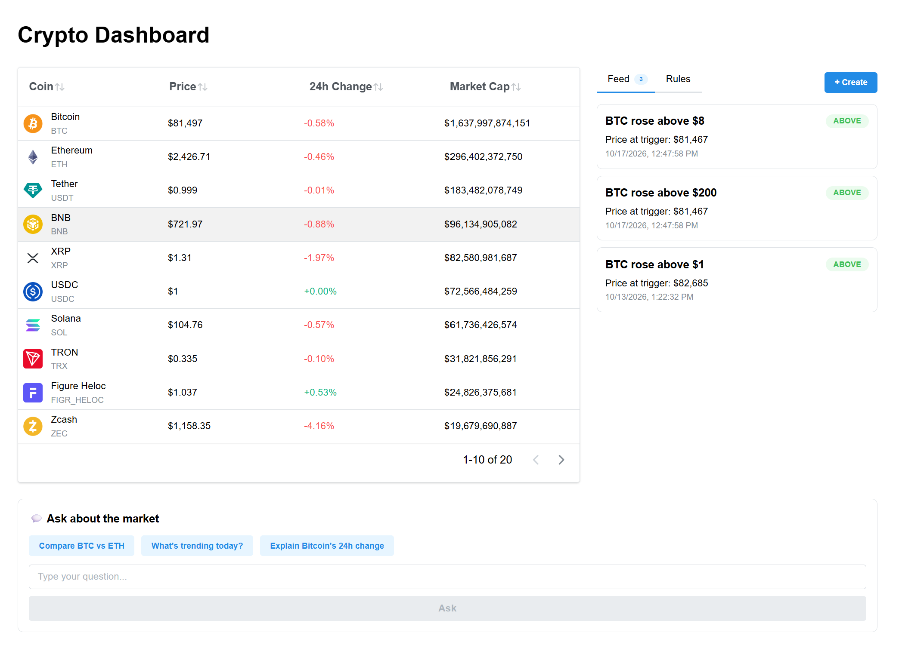

# Crypto Dashboard

A cryptocurrency dashboard with a serverless backend on AWS, built with React and TypeScript. It covers the full path from the UI to the data layer: live market data, an AI assistant with tool use, and a price-alert system backed by DynamoDB, with testing, CI/CD, and cloud deployment around it.

**[Live Demo](https://d1qb67mzlj8228.cloudfront.net)** · **[Source Code](https://github.com/shirshovaanna53/crypto-dashboard-react)**



## Overview

Built as a hands-on project to work with technologies used in production engineering: real-time data fetching, serverless backends, a NoSQL data model, and automated CI/CD pipelines, end to end, from local development to a live, publicly accessible application.

## Key Features

- **Live-updating price table** with polling-based updates and a subtle flash animation highlighting actual price changes
- **Search, sort, and pagination** across the top 20 cryptocurrencies by market cap
- **Price history chart** (7-day trend) in a modal on row click, powered by Recharts
- **Price alerts** — create rules such as "notify me when BTC drops below $60,000", see which rules are active, and browse a feed of triggered alerts. Rules and events are stored in DynamoDB, so they persist between visits
- **AI market assistant** — a chat panel backed by Claude with tool use, answering questions with live market data rather than the model's static training knowledge
- **Loading, empty, and error states** handled throughout the UI

## Price Alerts

The alerts feature is the backend-heavy part of the project. The UI is a two-column layout: the coin table on the left, an alerts panel (Feed and Rules tabs) on the right.

### Architecture

```
Browser (React, RTK Query)
   │  GET /alerts, GET /alerts/feed, POST /alerts, DELETE /alerts/{id},
   │  POST /alerts/{id}/restart, POST /alerts/check
   ▼
API Gateway (HTTP API) ──► Lambda "api"  ──┐
                                           ├──► DynamoDB (single table)
EventBridge Scheduler (every hour) ──► Lambda "checker" ──┘      │
                                           │                     └─ TTL cleans up old items
                                           └──► CoinGecko (only for stale prices)
```

Both Lambdas share one price-checking module (`checker-core`), so a background run and an on-demand check behave identically.

### How a check works

1. Load the active rules (all users for the background run, one user for an on-demand check).
2. Collect the distinct coins, read their cached prices, and make **one** CoinGecko request only for coins whose cache is older than 5 minutes.
3. Evaluate each rule with a per-type evaluator.
4. For each rule that fired, run a DynamoDB transaction that closes the rule and writes a feed event in one atomic step.

When the page loads, the frontend shows the stored rules and feed immediately and, in parallel, asks the backend to run a check. If anything fired, the lists refresh themselves.

### DynamoDB design

One table, with the item type encoded in the sort key:

| Item                    | PK               | SK                              |
| ----------------------- | ---------------- | ------------------------------- |
| Alert rule              | `USER#<id>`      | `ALERT#<ruleId>`                |
| Triggered event (feed)  | `USER#<id>`      | `TRIGGERED#<ISO time>#<ruleId>` |
| Check rate-limit marker | `USER#<id>`      | `META#check`                    |
| Cached price            | `PRICE#<coinId>` | `LATEST`                        |

Access patterns and how they are served:

| Question                                       | How                                                                                                                                                                                      |
| ---------------------------------------------- | ---------------------------------------------------------------------------------------------------------------------------------------------------------------------------------------- |
| Rules of a user                                | `Query` on `PK`, `begins_with(SK, "ALERT#")`                                                                                                                                             |
| Latest triggered alerts of a user              | `Query` on `PK`, `begins_with(SK, "TRIGGERED#")`, `ScanIndexForward: false`. ISO timestamps sort chronologically, so no sorting in code                                                  |
| All active rules of all users (background job) | `Scan` of a **sparse GSI** (`byActiveCoin`, key `activeCoinId`). The attribute exists only while a rule is active and is removed when it fires, so the index never contains closed rules |
| Latest price of a coin                         | `BatchGet` on `PRICE#<coinId>`                                                                                                                                                           |

Rules are stored as `type` + `params` (for example `PRICE_THRESHOLD` with a direction and a target price). New rule types, such as "up more than 10% in 3 days", need a new evaluator function, not a schema change.

### Design decisions

- **Atomic transitions.** Closing a rule and writing its feed event happen in one transaction, guarded by `status = active`. If a background run and an on-demand check overlap, or a rule is deleted mid-check, the loser's transaction is cancelled: no duplicate events, and no half-written "zombie" items.
- **Expected outcomes are values, unexpected ones are exceptions.** A cancelled transaction caused by the condition is a normal race and returns `false`. Anything else is a real error and is thrown and logged.
- **Stale data is never used to fire an alert.** If CoinGecko fails for a coin, its rules are skipped until the next run, rather than evaluated against an old price.
- **Shared price cache in DynamoDB.** Two Lambdas and many containers cannot share an in-memory cache. A 5-minute shared cache bounds CoinGecko traffic regardless of how many clients call the API.
- **Two layers of rate limiting.** On-demand checks are limited to one per 60 seconds per user using a conditional write on `META#check` (atomic, so rapid clicks cannot slip through). The shared price cache protects the upstream API for all users together.
- **Cost-aware scheduling.** The background job runs hourly (about 720 CoinGecko calls per month at most, and none when there are no active rules). Polling every minute would have used far more of the API quota than a small project needs.
- **TTL for housekeeping.** Feed events expire after 30 days and cached prices after 24 hours, with no cleanup code. Freshness is decided by an explicit timestamp, not by TTL, because TTL deletion can lag.
- **Server-side validation.** The Lambda validates every field and caps rules at 20 per user, independent of the frontend form.
- **Least-privilege IAM.** Each Lambda's role is scoped to the one table and the index, with only the actions it needs.

### Known limitations

- **No authentication yet.** Users are identified by an `X-User-Id` header, a UUID that is not secret. This is a placeholder for Amazon Cognito. The live demo deliberately uses one shared demo identity, so every visitor sees the same rules and alerts, and anyone can change them.
- **Alerts are checked hourly or on page load, not continuously.** A price that crosses a threshold and returns before the next check is not detected, and the feed shows the time of the check, not the moment the price moved.
- **No push or email notifications** (an hourly check would make them possible, they are on the roadmap).
- **The feed shows the latest 50 events.** Cursor-based pagination is planned.
- **Triggers are processed sequentially.** Fine for hundreds of rules; beyond that they would be processed in parallel or split by coin.

### Roadmap

- Cursor-based infinite scroll for the feed (DynamoDB `LastEvaluatedKey` as the cursor)
- Sign-in with Amazon Cognito instead of the placeholder identity
- Email notifications via SES
- Percent-change rules (for example "up more than 10% in 3 days") backed by a stored price history
- Infrastructure as code (CDK or SAM) and a shared Lambda layer instead of copying the common module

## AI Agent (Tool Use)

- **Claude-powered chat assistant** integrated as a Lambda route (`/ai/chat`), separate from the CoinGecko proxy but sharing the same modular Lambda codebase
- **Tool use / function calling** — rather than answering from static training data, Claude is given two tools (`get_coin_data`, `get_price_history`) and autonomously decides which to call based on the user's question, then formulates a response grounded in the real result
- **Agent loop with a hard iteration cap** — the tool-use exchange runs in a loop until Claude returns a final answer, bounded by `MAX_TOOL_ITERATIONS` to guard against runaway agent behavior rather than relying solely on the Lambda timeout as a safety net
- **Token-conscious tool design** — `get_price_history` downsamples the API's hourly data points to one per day before returning them to the model, reducing both token cost and irrelevant noise in the tool result
- **Scoped via system prompt** — the assistant is instructed to stay on crypto-market topics and redirect off-topic questions, rather than relying on hard-coded input filtering
- **Guided + open input** — suggested-question chips steer users toward what the assistant can actually help with, alongside a free-text input for open-ended questions

## Frontend Highlights

### State Management & Data Fetching

- **Redux Toolkit + RTK Query** for API integration, caching, and automatic re-fetching
- **Tag-based cache invalidation** for alerts: creating, deleting, or restarting a rule refreshes the lists automatically, so the server stays the single source of truth and there is no duplicated local state
- **Conditional invalidation** — an on-demand check refreshes the lists only if something actually fired
- **Polling** for prices, tuned to match the underlying data source's actual refresh rate, avoiding wasted requests
- **Request deduplication** via RTK Query's caching — for example, the coin list is shared between the table and the alert form
- **Skip queries** on demand (`skip: !coinId`) so the price-history endpoint is only called when a modal is actually open

### Code Quality & Maintainability

- **Single source of truth** for design tokens and copy — colors, durations, and error messages are centralized in `constants/`
- **TypeScript throughout**, with shared type definitions decoupled from the API layer (`types/`)
- **Presentational components** (`AlertRulesList`, `AlertsFeed`) receive data and callbacks through props and know nothing about the API
- **ESLint + Prettier**, including `eslint-plugin-react-hooks` to catch incorrect hook usage early

### Testing

- **Vitest + React Testing Library** covering:
  - Custom hook logic in isolation (`usePriceFlash`)
  - Component rendering and visual states (loading, error, success)
  - Mocked RTK Query hooks to keep tests fast and independent of the live API

## Infrastructure & DevOps

- **Deployed on AWS** — S3 for static hosting, CloudFront as CDN with HTTPS
- **Serverless API** — Lambda functions behind API Gateway, using a declarative route table (pattern → handler) instead of nested conditionals, so adding an endpoint is a one-line addition
- **DynamoDB** (on-demand capacity) with a sparse GSI and TTL
- **EventBridge Scheduler** triggering the hourly background checker
- **CI/CD via GitHub Actions** — every push to `main` builds the app, syncs it to S3, and invalidates the CloudFront cache
- **Observability** — structured JSON log lines per check run (rules checked, coins fetched, alerts fired) in CloudWatch Logs
- **Secrets management** — API keys and AWS credentials handled via GitHub Actions secrets and Lambda environment variables, never committed to the repository

### Security & Accessibility

- **API key kept server-side** — initially the CoinGecko key was bundled into the frontend build (a common pitfall with static deployments, verified firsthand by inspecting the built bundle). This was resolved by introducing a Lambda + API Gateway proxy: the browser calls the proxy with no credentials attached, and the key lives only in the Lambda's environment variables
- Visible, non-default focus states on interactive elements (for example the modal close button) for keyboard navigation

## Tech Stack

React · TypeScript · Redux Toolkit · RTK Query · Mantine · Recharts · Vitest · React Testing Library · Vite · GitHub Actions · AWS (S3, CloudFront, Lambda, API Gateway, DynamoDB, EventBridge Scheduler, CloudWatch, IAM) · Anthropic API (Claude, tool use)

## Data Source

Live market data from the [CoinGecko API](https://www.coingecko.com/en/api).

## Running Locally

```bash
npm install --legacy-peer-deps
npm run dev
```

Requires a `.env` file pointing to the Lambda proxy:

```
VITE_LAMBDA_API_URL=your_api_gateway_invoke_url
# Optional: use a fixed identity (as the live demo does) instead of a per-browser random one
VITE_DEMO_USER_ID=your_uuid
```

Without `VITE_DEMO_USER_ID`, the app generates a random user id in the browser's `localStorage`, so each browser starts with its own empty list of alerts.

## Running Tests

```bash
npm run test
```
